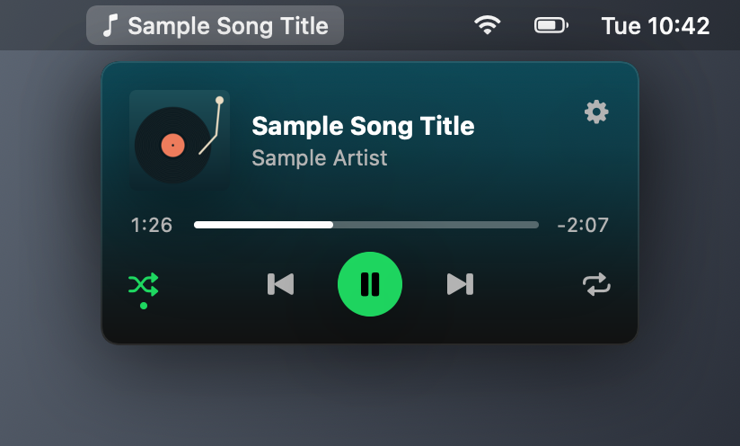

# Tonearm

[](https://github.com/Abulkosim/tonearm/releases/latest)
[](https://github.com/Abulkosim/tonearm/actions/workflows/ci.yml)

A mini player for the Spotify desktop app that lives in the Mac menu bar.


Click the song in the menu bar to see the cover, title and artist. Play, pause, skip, shuffle, repeat, seek and change the volume from there. There is a compact layout with a small cover, keyboard shortcuts, and optional global shortcuts that work in any app. No account and no login.



## Install

With [Homebrew](https://brew.sh):

```sh
brew install --cask abulkosim/tap/tonearm
```

Or download [Tonearm.dmg](https://github.com/Abulkosim/tonearm/releases/latest/download/Tonearm.dmg), open it and drag Tonearm to Applications.

Tonearm needs macOS 13 or later and the Spotify desktop app. It runs on Apple Silicon and Intel Macs.

### The first time you open it

Tonearm is not notarized by Apple ([why](docs/faq.md#why-isnt-tonearm-notarized-or-in-the-app-store)), so macOS blocks it the first time. You do this once. Homebrew does it for you.

- macOS 15 and later: open Tonearm and close the warning. Then open System Settings → Privacy & Security, scroll down and click Open Anyway.
- macOS 13 and 14: right-click Tonearm in Applications, choose Open, then click Open.
- Or in Terminal:

  ```sh
  xattr -dr com.apple.quarantine /Applications/Tonearm.app
  ```

Then macOS asks "Tonearm wants to control Spotify". Click OK. Tonearm needs this to read what's playing and to play, pause and skip.

### Where is it?

In the menu bar at the top right of the screen, next to the clock. Tonearm has no Dock icon and no main window. Click the song title, or the disc icon when nothing is playing, to open the player. The first time you open Tonearm, a short welcome window shows where it is.

On a MacBook with a notch, a full menu bar hides icons behind the notch. If you can't see Tonearm, quit a few other menu bar apps, or hide system icons in System Settings → Control Center. Once you see it, choose Icon only in Tonearm's settings to keep it short.

## Updates

Tonearm checks for updates once a day and installs them itself. To check now, open the player, click the gear and click Check for Updates…. Updates keep the Spotify permission.

If you have v0.2.0 or earlier, install the latest version once by hand as above. Quit the old one first (gear → Quit Tonearm). From then on it updates itself.

## Shortcuts

While the player is open:

| Key | Action |
| --- | --- |
| Space | Play or pause |
| ← → | Seek 10 seconds |
| ⌘← ⌘→ | Previous, next |
| ↑ ↓ | Volume |
| S, R | Shuffle, repeat |
| ⌘, | Settings |
| ⌘Q | Quit |

Global shortcuts, if you turn them on in settings: ⌃⌥P play or pause, ⌃⌥N next, ⌃⌥B previous.

## Permission

Tonearm controls Spotify through Apple Events, so macOS asks once. If you clicked Don't Allow, open System Settings → Privacy & Security → Automation → Tonearm and turn on Spotify. If Tonearm isn't listed there, see [docs/permissions.md](docs/permissions.md).

## Privacy

Tonearm has no analytics and no account. It talks to the Spotify app on your Mac through AppleScript and never uses the Spotify Web API.

It makes two kinds of network requests: it downloads the cover image from the URL Spotify reports, and once a day it asks GitHub whether there is a new version.

## Uninstall

With Homebrew:

```sh
brew uninstall --zap --cask tonearm
```

By hand:

1. Quit Tonearm: open the player, click the gear, then Quit Tonearm.
2. Drag Tonearm from Applications to the Trash.
3. Remove the permission and settings in Terminal:

   ```sh
   tccutil reset AppleEvents io.github.abulkosim.tonearm
   defaults delete io.github.abulkosim.tonearm
   rm -rf ~/Library/Caches/io.github.abulkosim.tonearm \
     ~/Library/HTTPStorages/io.github.abulkosim.tonearm \
     ~/Library/Application\ Support/io.github.abulkosim.tonearm
   ```

## Questions

- [macOS says the item is in use when I replace Tonearm](docs/faq.md#macos-says-the-item-is-in-use-when-i-replace-tonearm)
- [Nothing happens when I open it](docs/faq.md#nothing-happens-when-i-open-it)
- [It says Spotify isn't running, but it is](docs/faq.md#it-says-spotify-isnt-running-but-it-is)
- [Why isn't Tonearm notarized or in the App Store?](docs/faq.md#why-isnt-tonearm-notarized-or-in-the-app-store)

More in [docs/faq.md](docs/faq.md).

## How it works

Tonearm talks to the Spotify desktop app through its AppleScript dictionary, the same way a script in Script Editor would. Spotify posts a `com.spotify.client.PlaybackStateChanged` notification whenever the track or play state changes, and Tonearm reads the new state then. A slow timer covers any notification it misses.

## Build from source

Needs macOS 13 or later and Xcode 15 or later (Swift 5.9).

```sh
git clone https://github.com/Abulkosim/tonearm.git
cd tonearm
scripts/build-app.sh
open build/Tonearm.app
```

See [CONTRIBUTING.md](CONTRIBUTING.md) for tests and pull requests, and [docs/releasing.md](docs/releasing.md) for how releases are made.

## Not affiliated with Spotify

Tonearm is an independent project. It is not made, endorsed or supported by Spotify. Spotify is a trademark of Spotify AB.

## License

MIT. See [LICENSE](LICENSE).
