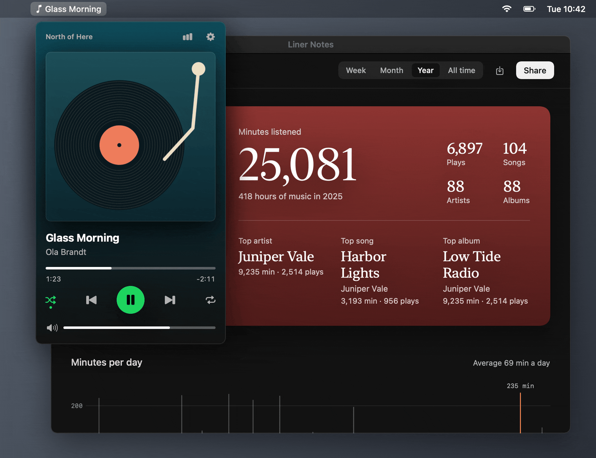
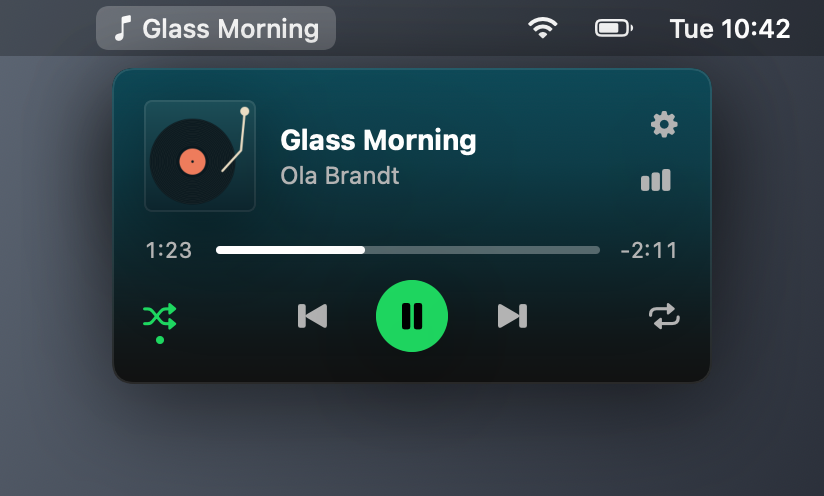
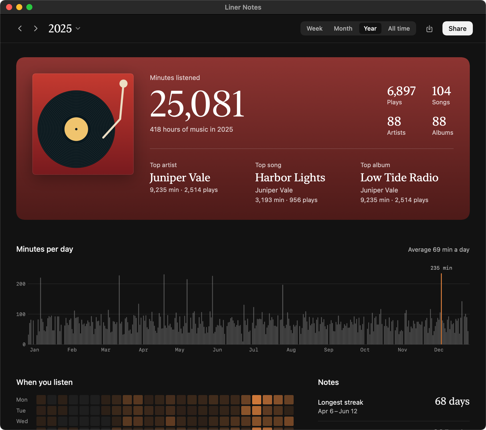
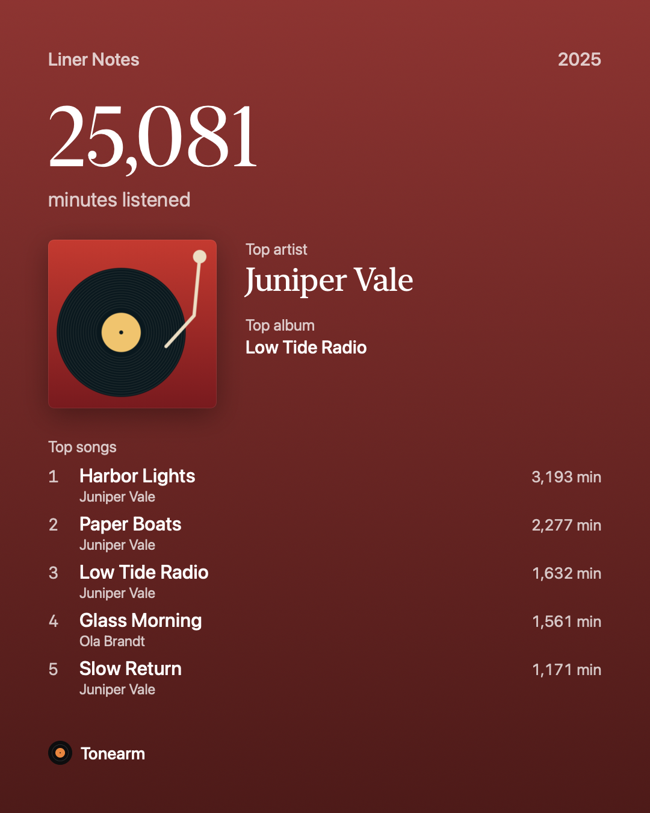

# Tonearm

[](https://github.com/Abulkosim/tonearm/releases/latest)
[](https://github.com/Abulkosim/tonearm/actions/workflows/ci.yml)

A mini player for the Spotify desktop app, in the Mac menu bar.
It also keeps a record of what you play, on your Mac, and shows it as Liner Notes: your top artists, songs and albums for any week, month, year or all time.



## Install

With [Homebrew](https://brew.sh):

```sh
brew install --cask abulkosim/tap/tonearm
```

Or download [Tonearm.dmg](https://github.com/Abulkosim/tonearm/releases/latest/download/Tonearm.dmg), open it and drag Tonearm to Applications.

Tonearm needs macOS 13 or later and the Spotify desktop app. It runs on Apple Silicon and Intel Macs. It is free and has no account or login.

### The first time you open it

Tonearm is not notarized by Apple ([why](docs/faq.md#why-isnt-tonearm-notarized-or-in-the-app-store)), so macOS blocks it the first time. You do this once. Homebrew does it for you.

- macOS 15 and later: open Tonearm and close the warning. Then open System Settings → Privacy & Security, scroll down to Security and click Open Anyway, then enter your password. The button is there for about an hour after you tried to open Tonearm. (Right-clicking the app and choosing Open no longer works on macOS 15.)
- macOS 13 and 14: Control-click (or right-click) Tonearm in Applications, choose Open, then click Open.
- Or in Terminal, on any version:

  ```sh
  xattr -dr com.apple.quarantine /Applications/Tonearm.app
  ```

Then macOS asks "Tonearm wants to control Spotify". Click OK. Tonearm needs this to read what's playing and to play, pause and skip.

### Where is it?

In the menu bar at the top right of the screen, next to the clock. Tonearm has no Dock icon and no main window. Click the song title, or the disc icon when nothing is playing, to open the player. The first time you open Tonearm, a short welcome window shows where it is.

On a MacBook with a notch, a full menu bar hides icons behind the notch. If you can't see Tonearm, quit a few other menu bar apps, or hide system icons in System Settings → Control Center. Once you see it, choose Icon only in Tonearm's settings to keep it short.

## The player

Click the song in the menu bar to see the cover, title and artist. Play, pause, skip, shuffle, repeat, seek and change the volume from there. The background takes its color from the cover. There is a compact layout with a small cover, keyboard shortcuts, and optional global shortcuts that work in any app.



## Liner Notes

Tonearm keeps a record of each song you play while it runs. Liner Notes shows it: minutes listened, plays, top artists, songs and albums, minutes per day, the hours and days you listen, and your longest streak, for any week, month, year or all time. To open it, click the chart button next to the gear in the player, or press ⌘L.



A new install starts with no history. To see years of it, ask Spotify for your data at [spotify.com/account/privacy](https://www.spotify.com/account/privacy/) and import the .zip in Settings → History. "Extended streaming history" covers every year and takes Spotify up to 30 days to send. "Account data" covers the past year and takes a few days.

Share makes a picture of the period to post or send:



The history is an SQLite file in `~/Library/Application Support/Tonearm`. Liner Notes makes no network requests. In Settings → History you can export everything as CSV or JSON, delete it all, or turn recording off. If you use [ListenBrainz](https://listenbrainz.org), Tonearm can send your listens there too; that is off until you paste your token. Details in [docs/history.md](docs/history.md).

The pictures here are rendered by the app from a made-up history; the artists in them don't exist.

## Updates

Tonearm checks for updates once a day and installs them itself. To check now, open the player, click the gear and click Check for Updates…. Updates keep the Spotify permission.

If you have v0.2.0 or earlier, install the latest version once by hand as above. Quit the old one first (gear → Quit Tonearm). From then on it updates itself.

## Shortcuts

While the player is open:

| Key | Action |
| --- | --- |
| Space | Play or pause |
| ← → | Seek 10 seconds |
| ⌘← ⌘→ | Previous, next |
| ↑ ↓ | Volume |
| S, R | Shuffle, repeat |
| ⌘, | Settings |
| ⌘L | Liner Notes |
| ⌘Q | Quit |

Global shortcuts, if you turn them on in settings: ⌃⌥P play or pause, ⌃⌥N next, ⌃⌥B previous.

## Permission

Tonearm controls Spotify through Apple Events, so macOS asks once. If you clicked Don't Allow, open System Settings → Privacy & Security → Automation → Tonearm and turn on Spotify. If Tonearm isn't listed there, see [docs/permissions.md](docs/permissions.md).

## Privacy

Tonearm has no analytics and no account. It talks to the Spotify app on your Mac through AppleScript and never uses the Spotify Web API.

It makes two kinds of network requests: it downloads the cover image from the URL Spotify reports, and once a day it asks GitHub whether there is a new version. A third only if you turn it on: sending your listens to ListenBrainz. Liner Notes makes none; it shows only covers the player already downloaded.

Your listening history stays in `~/Library/Application Support/Tonearm`. See [docs/history.md](docs/history.md) for what is in it.

## Uninstall

With Homebrew:

```sh
brew uninstall --zap --cask tonearm
```

By hand:

1. Quit Tonearm: open the player, click the gear, then Quit Tonearm.
2. Drag Tonearm from Applications to the Trash.
3. Remove the permission and settings in Terminal:

   ```sh
   tccutil reset AppleEvents io.github.abulkosim.tonearm
   defaults delete io.github.abulkosim.tonearm
   rm -rf ~/Library/Caches/io.github.abulkosim.tonearm \
     ~/Library/HTTPStorages/io.github.abulkosim.tonearm \
     ~/Library/Application\ Support/io.github.abulkosim.tonearm \
     ~/Library/Application\ Support/Tonearm
   security delete-generic-password -s io.github.abulkosim.tonearm.listenbrainz 2>/dev/null
   ```

   `Application Support/Tonearm` holds your listening history. The `security` line removes the ListenBrainz token, if you added one.

## Questions

- [macOS says the item is in use when I replace Tonearm](docs/faq.md#macos-says-the-item-is-in-use-when-i-replace-tonearm)
- [Nothing happens when I open it](docs/faq.md#nothing-happens-when-i-open-it)
- [It says Spotify isn't running, but it is](docs/faq.md#it-says-spotify-isnt-running-but-it-is)
- [Why isn't Tonearm notarized or in the App Store?](docs/faq.md#why-isnt-tonearm-notarized-or-in-the-app-store)
- [Does it work with Apple Music or other players?](docs/faq.md#does-it-work-with-apple-music-or-other-players)
- [Does it use my Spotify account or the Spotify Web API?](docs/faq.md#does-it-use-my-spotify-account-or-the-spotify-web-api)
- [Which Macs does it run on?](docs/faq.md#which-macs-does-it-run-on)
- [Does Tonearm send my listening history anywhere?](docs/faq.md#does-tonearm-send-my-listening-history-anywhere)

More in [docs/faq.md](docs/faq.md).

## How it works

Tonearm talks to the Spotify desktop app through its AppleScript dictionary, the same way a script in Script Editor would. Spotify posts a `com.spotify.client.PlaybackStateChanged` notification whenever the track or play state changes, and Tonearm reads the new state then. A slow timer covers any notification it misses.

## Build from source

Needs macOS 13 or later and Xcode 15 or later (Swift 5.9).

```sh
git clone https://github.com/Abulkosim/tonearm.git
cd tonearm
scripts/build-app.sh
open build/Tonearm.app
```

See [CONTRIBUTING.md](CONTRIBUTING.md) for tests and pull requests, and [docs/releasing.md](docs/releasing.md) for how releases are made.

## Not affiliated with Spotify

Tonearm is an independent project. It is not made, endorsed or supported by Spotify. Spotify is a trademark of Spotify AB.

## License

MIT. See [LICENSE](LICENSE).
