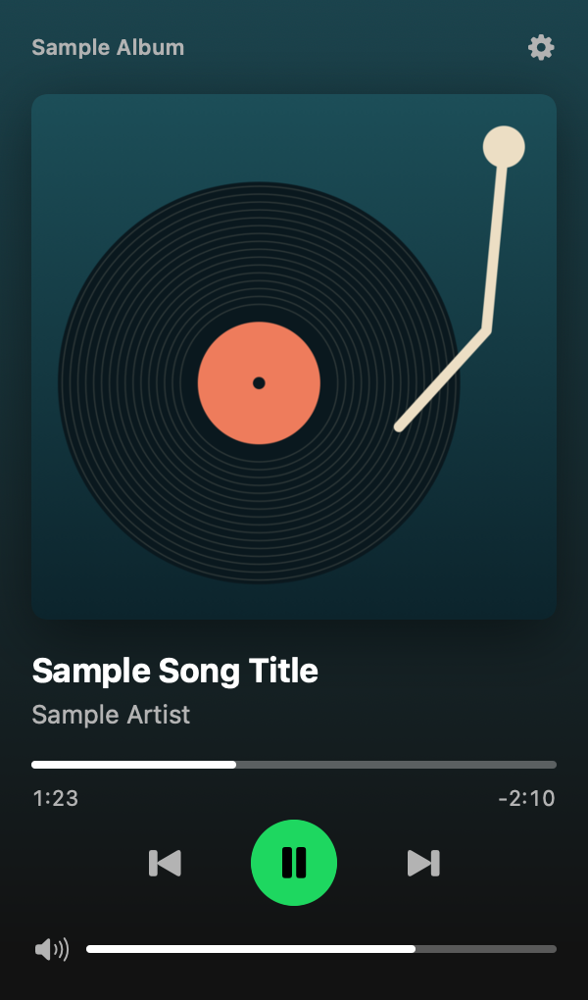

# Tonearm

[](https://github.com/Abulkosim/tonearm/releases/latest)

A small player in the macOS menu bar for the Spotify desktop app.



## Features

- The current song in the menu bar, with or without the artist, or just an icon.
- Click it to see the cover, title and artist.
- Play, pause, next and previous.
- Drag the progress bar to seek. Drag the volume bar to change Spotify's volume.
- The background takes its colors from the cover.
- Updates as soon as Spotify changes track or state.
- Optional launch at login.
- No account, no login, no Dock icon.

## Install

1. Download `Tonearm.dmg` or `Tonearm.zip` from [Releases](https://github.com/Abulkosim/tonearm/releases/latest).
2. Drag Tonearm to Applications.
3. Open it.

The app may not be notarized by Apple, so macOS will block it the first time. To open it anyway:

- macOS 15 and later: try to open Tonearm once, then go to System Settings → Privacy & Security, scroll down and click "Open Anyway".
- macOS 13 and 14: right-click Tonearm in Applications, choose Open, then click Open.
- Or, in Terminal:

  ```sh
  xattr -dr com.apple.quarantine /Applications/Tonearm.app
  ```

## First run

macOS asks once: "Tonearm wants to control Spotify". Click OK. Tonearm needs this to read what's playing and to send play, pause and skip.

## How it works

Tonearm talks to the Spotify desktop app through its AppleScript dictionary, the same way a script in Script Editor would. Spotify posts a `com.spotify.client.PlaybackStateChanged` notification whenever the track or play state changes, and Tonearm reads the new state then. A slow timer covers any notification it misses.

It does not use the Spotify Web API. There is no login and no API key. The only network request is downloading the cover image from the URL Spotify reports.

Spotify must be installed and running.

## Permission denied?

If you clicked "Don't Allow", open System Settings → Privacy & Security → Automation → Tonearm and turn on Spotify. If Tonearm isn't listed, see [docs/permissions.md](docs/permissions.md).

## Build from source

Needs macOS 13 or later and Xcode 15 or later (Swift 5.9).

```sh
git clone https://github.com/Abulkosim/tonearm.git
cd tonearm
scripts/build-app.sh
open build/Tonearm.app
```

The script builds a universal binary and signs it ad hoc. See [CONTRIBUTING.md](CONTRIBUTING.md) for more.

## Not affiliated with Spotify

Tonearm is an independent project. It is not made, endorsed or supported by Spotify. Spotify is a trademark of Spotify AB.

## License

MIT. See [LICENSE](LICENSE).
